# Diagrams

UML views of the codebase, in Mermaid (GitHub renders them). Keep them in
sync with the code: a change that adds, removes or renames a module, file,
exported type/function, route, job state or flow updates the matching
diagram in the same change. Prose and rules live in `ARCHITECTURE.md`.

1. [Components](#1-components)
2. [core: classes](#2-core-classes)
3. [server: classes](#3-server-classes)
4. [cli: classes](#4-cli-classes)
5. [web demo: classes](#5-web-demo-classes)
6. [Sequence: CLI convert](#6-sequence-cli-convert)
7. [Sequence: async job from the web demo](#7-sequence-async-job-from-the-web-demo)
8. [Sequence: POST /convert and POST /probe](#8-sequence-post-convert-and-post-probe)
9. [States: server job](#9-states-server-job)
10. [States: web demo](#10-states-web-demo)
11. [Deployment: Docker image](#11-deployment-docker-image)

## 1. Components

Arrows are imports / calls. cli and server reach core only through `#core`
(`src/core/index.ts`); the web demo reaches the server only over HTTP.

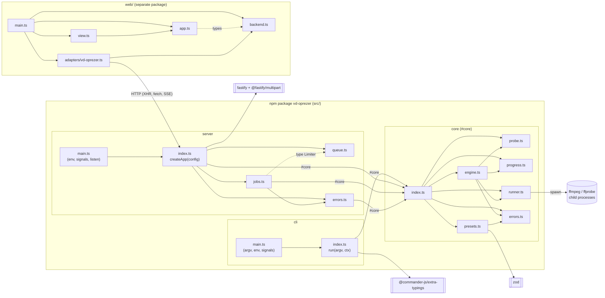

## 2. core: classes

Factory functions and plain objects, drawn as classes. `«factory»` marks a
function that returns the object it points to.

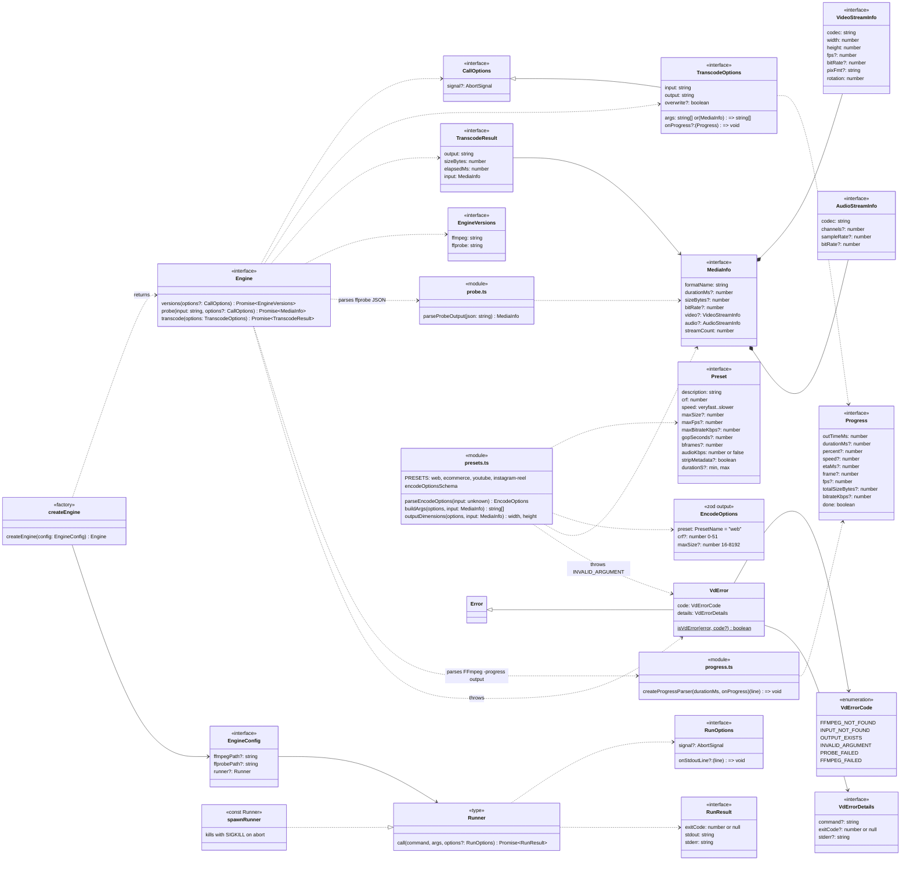

## 3. server: classes

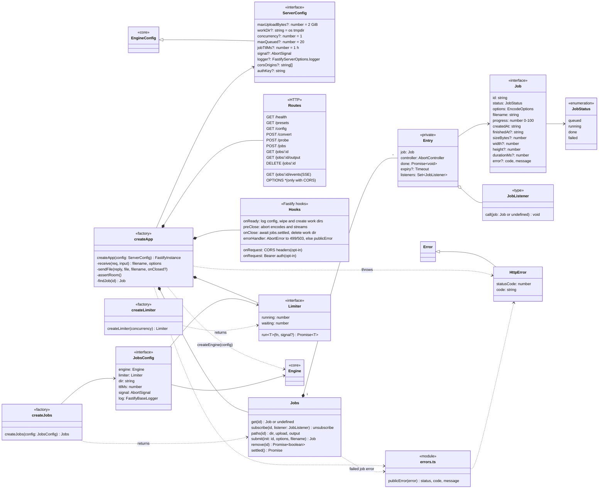

## 4. cli: classes

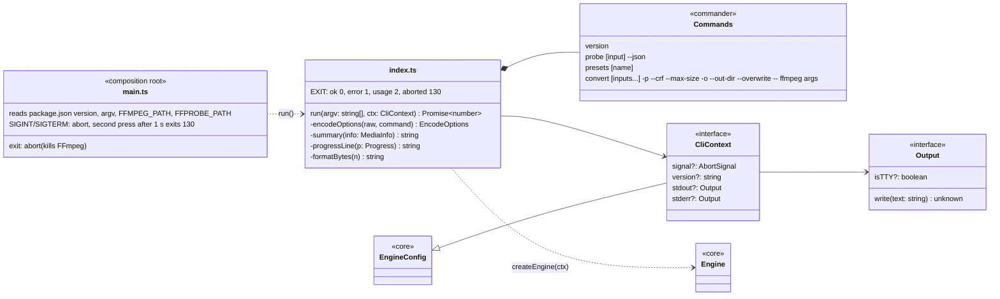

## 5. web demo: classes

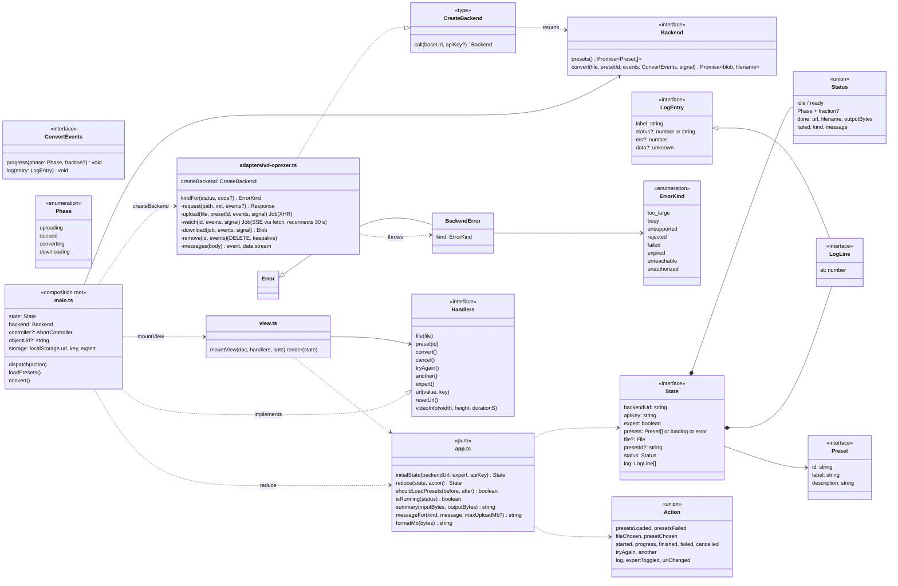

## 6. Sequence: CLI convert

`vd-oprezer convert clip.mov -p web -- '-c:v' libx264`

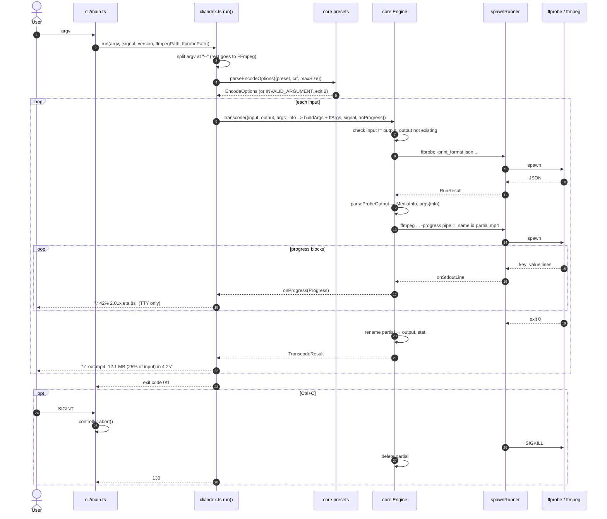

## 7. Sequence: async job from the web demo

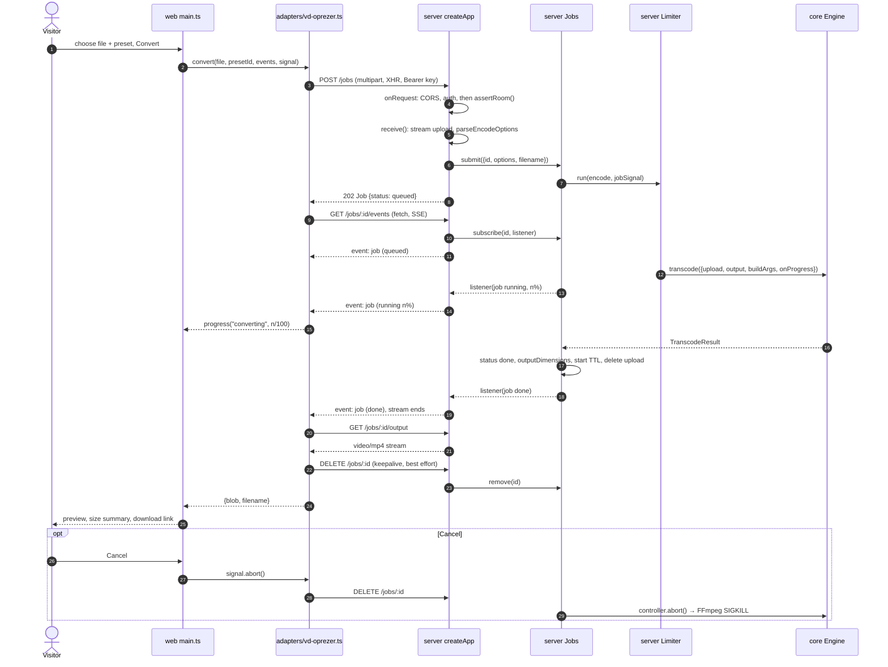

## 8. Sequence: POST /convert and POST /probe

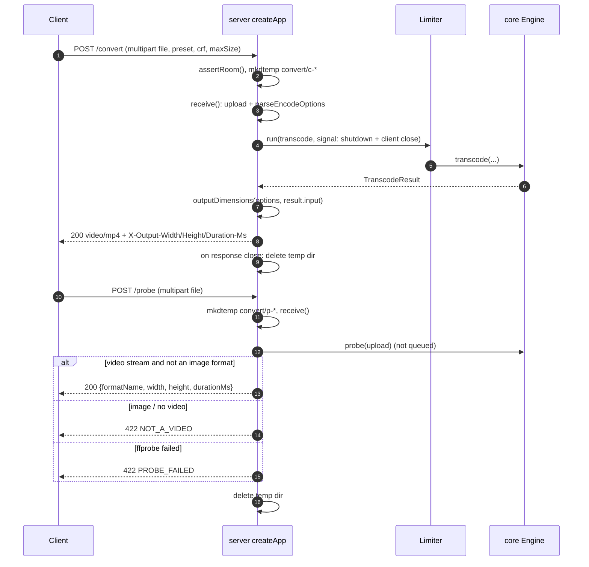

## 9. States: server job

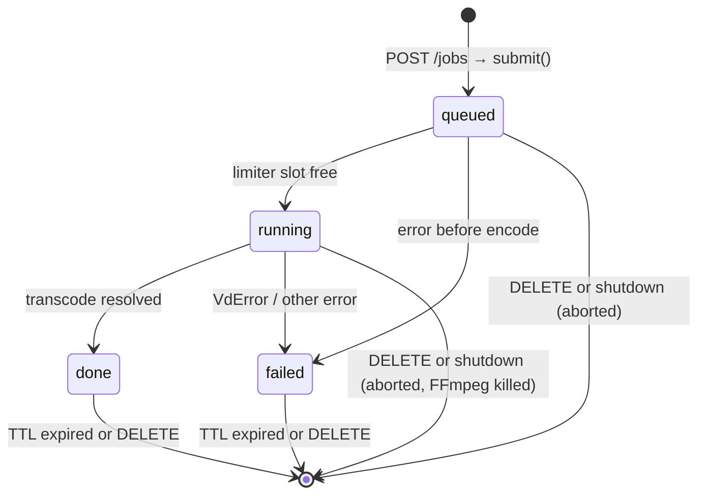

## 10. States: web demo

`Status` in `web/src/app.ts`, driven by `reduce(state, action)`.

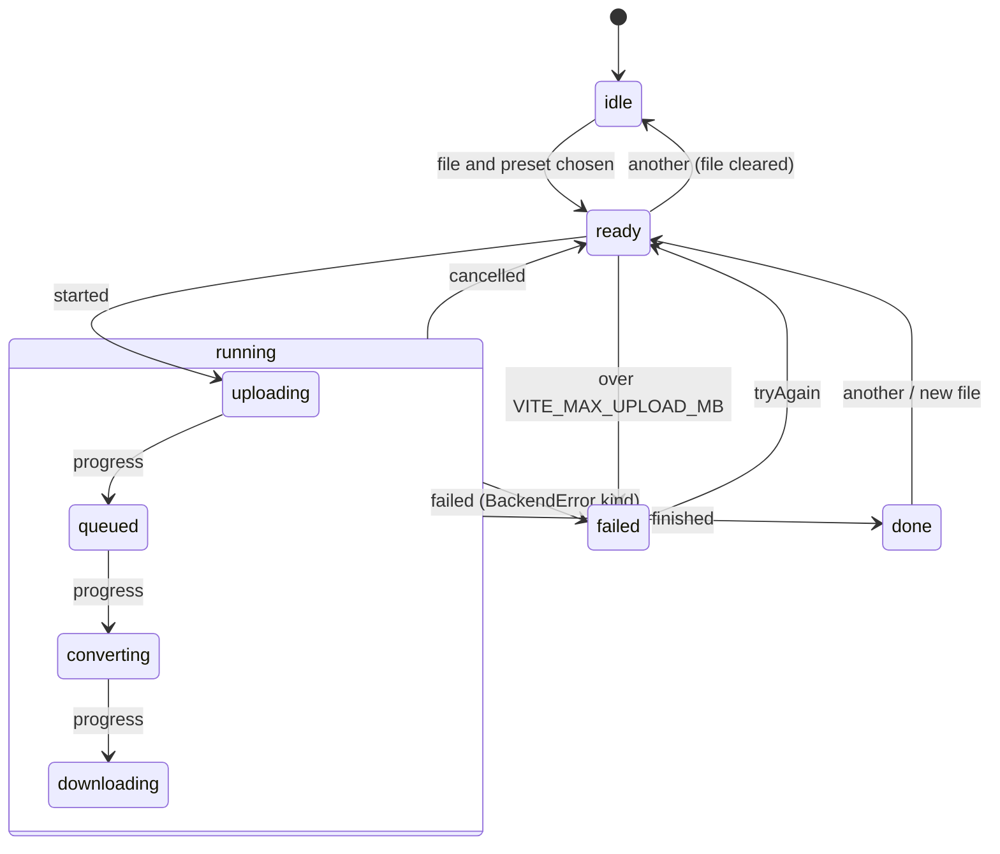

## 11. Deployment: Docker image

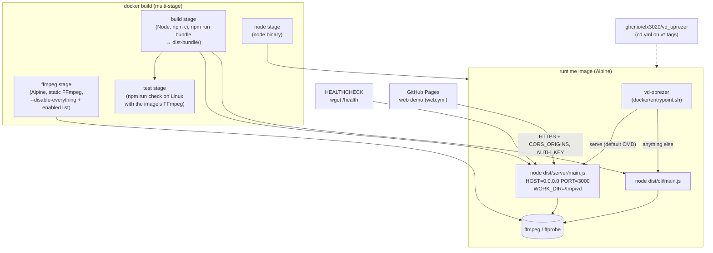
